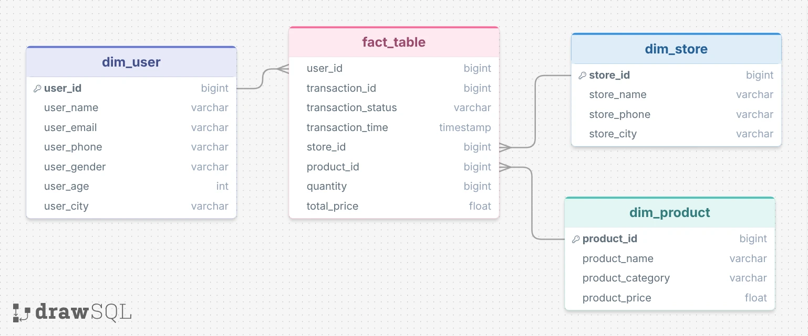

# E-Commerce Transaction Data Warehouse & Analysis

This project builds a simple ELT pipeline and a star-schema data warehouse from e-commerce transaction data using **PostgreSQL**, then uses it to answer business questions about transaction performance and customer behavior.

**Tools:** PostgreSQL (SQL), drawSQL (ERD), GitHub

**Dataset:** [ecommerce_transaction.sql](https://github.com/ikhsannur1996/store-procedure-assignment/blob/main/ecommerce_transaction.sql)

**Data period:** January 1, 2025 – March 28, 2025

---

## 1. Project Background

An e-commerce company generates large volumes of transaction data every day. In its initial state, all information (customers, stores, products, and transactions) is stored in **one large table** (`ecommerce_transaction`). This structure is hard to use for repeated analysis because:

- customer, store, and product data are duplicated on every transaction row,
- data formats are inconsistent (for example, mixed upper/lower case in email, gender, and city fields),
- transaction time is stored as a timestamp, which is less convenient for daily analysis.

To address this, the data is moved into a **staging** layer, cleaned, and then modeled into a **data warehouse** using a **star schema**, making it more efficient and consistent to analyze.

### Data Architecture

```
public.ecommerce_transaction        (source / raw)
        │
        ▼
stg.stg_raw_ecommerce_transaction   (raw copy in staging)
        │   transformation
        ▼
stg.stg_ecommerce_transaction       (cleaned data)
        │
        ▼
dwh.dim_user · dwh.dim_store · dwh.dim_product · dwh.fact_table
```

### Entity Relationship Diagram



| Table | Type | Contents |
|---|---|---|
| `fact_table` | Fact | `transaction_id`, `transaction_time`, `user_id`, `store_id`, `product_id`, `quantity`, `total_price` |
| `dim_user` | Dimension | `user_id`, name, email, phone, gender, age, city |
| `dim_store` | Dimension | `store_id`, store name, phone, city |
| `dim_product` | Dimension | `product_id`, product name, category, price |

---

## 2. Problem Statement, Analysis Objectives, and Business Problem

### Problem Statement
Transaction data sits in a single raw table that is not structured for analysis. As a result, the business team lacks a clear, measurable view of daily transaction performance and customer behavior.

### Analysis Objectives
1. Build a clean, reusable **staging → data warehouse** pipeline.
2. Design a **star schema** data model (1 fact table and 3 dimension tables).
3. Answer business questions with SQL on top of the data warehouse.

### Business Questions
1. What is the average daily transaction value?
2. What is the daily trend of total customer transactions?
3. Which customer made the most transactions?

---

## 3. Analysis

### 3.1 Data Understanding

- The source is the `ecommerce_transaction` table, with one row per transaction.
- Available columns cover **transaction** details (ID, time, quantity, total price), **user** details (name, email, phone, gender, age, city), **store** details (ID, name, phone, city), and **product** details (ID, name, category, price).
- Data types were checked via `information_schema.columns` before transformation.
- Data range: **January 1 – March 28, 2025**.

### 3.2 Data Preprocessing

All steps are in [`data preprocessing.sql`]

| Step | Description |
|---|---|
| 1. Raw staging | Copy the source data into `stg.stg_raw_ecommerce_transaction` so the original data stays untouched. |
| 2. Transformation | `transaction_time` is converted from timestamp to date (`date()`), and `user_email`, `user_gender`, `user_city`, `store_city`, and `product_category` are standardized to lowercase (`lower()`). The result is stored in `stg.stg_ecommerce_transaction`. |
| 3. Dimension tables | `dim_user`, `dim_store`, and `dim_product` are created with `SELECT DISTINCT` to remove duplicates. |
| 4. Fact table | `fact_table` holds the foreign keys and transaction measures: `quantity` and `total_price`. |

### 3.3 Analysis and Insights

#### Insight 1: Average Daily Transaction

```sql
select
    transaction_time,
    round(avg(total_price)::numeric, 2) avg_transaction
from dwh.fact_table
group by 1
order by 1;
```

- The **lowest** average daily transaction is **1,165,206.48** on **February 16, 2025**.
- The **highest** average daily transaction is **2,676,215** on **March 28, 2025**.

#### Insight 2: Daily Trend of Total Transactions

```sql
select
    transaction_time,
    round(sum(total_price)::numeric, 2) total_sales
from dwh.fact_table
group by 1
order by 1;
```

- The **highest** daily total occurred on **February 7, 2025**, at **141,190,000**.
- The **lowest** daily total occurred on **March 28, 2025**, at **21,409,700**.
- There is considerable fluctuation over the period, so the underlying causes should be evaluated.

> **Interpretation note:** March 28, 2025 has the highest average transaction value and the lowest total at the same time. This combination suggests very few transactions on that day, and the data for that day may be incomplete (it is the last day in the dataset). Check the daily transaction count before concluding there was a performance drop.

#### Insight 3: Customer with the Most Transactions

```sql
select
    user_id,
    count(*) total_transaction
from dwh.fact_table
group by 1
order by 2 desc;
```

- The customer with the most transactions is **`user_id = 45`**, with **72 transactions**.

---

## 4. Recommendations and Actionable Insights

1. **Investigate the spike and the drops.**
   Find out what happened on February 7, 2025 (the peak) and on low-total days: promotions, events, campaigns, or technical issues. Successful patterns can be replicated, and causes of drops can be fixed.

2. **Validate completeness of the last day's data.**
   Add a daily transaction count metric (`count(*)`) and confirm that March 28, 2025 is complete before using it for decisions.

3. **Manage high-value customers (`user_id = 45`).**
   The most frequent customer is a good candidate for a loyalty program, exclusive offers, or early access to improve retention. Further analysis can look at their city, favorite product categories, and stores.

4. **Use average transaction value to shape promotions.**
   Days with low average transaction value (such as February 16, 2025) can be targeted with promos, bundling, or minimum-purchase offers to lift order value.

5. **Next steps for analysis.**
   - Analyze by product category, store, and city.
   - Segment customers by age and gender.
   - Analyze by `transaction_status` to separate successful and failed transactions.
   - Visualize daily trends in a dashboard (Metabase, Looker Studio, or Power BI).

---

## Project Limitations

- The `transaction_status` column appears in the ERD but is not carried into `stg_ecommerce_transaction` or `fact_table` in the current SQL script. The transaction status filter is also not applied, so all transactions are counted. Align the ERD and the script for consistency.
- `dim_product` uses `SELECT DISTINCT` including `product_price`. If a product's price changes, its `product_id` may appear more than once. Primary keys are also not explicitly defined on the dimension tables.
- Results only cover January 1 – March 28, 2025.

---

## Repository Structure

```
├── README.md
├── data preprocessing.sql       # Staging, transformation, DWH, and analysis script
├── drawSQL-image-export-2026-07-09.webp  # Star schema ERD
```

## Author

**Fatih Putra M**
